<div align="center">



<picture>
  <source media="(prefers-color-scheme: dark)" srcset="https://readme-typing-svg.demolab.com?font=Fira+Code&weight=500&size=22&duration=3000&pause=1000&color=67E8F9&center=true&vCenter=true&width=640&lines=Training+%26+fine-tuning+AI+models;Data+%E2%86%92+Model+%E2%86%92+Production;Full-stack%3A+interface+to+infrastructure;New+challenge%3A+AI+security;Secure+by+design%2C+shipped+end+to+end" />
  
</picture>

<br />


</div>


## 🧬 About Me

I'm a **full-stack and AI engineer** who builds intelligent systems end to end, from the data pipelines and training runs that shape a model to the APIs and interfaces that put it in people's hands.

My focus today is **AI training**: curating high-quality data, training and fine-tuning models, evaluating them rigorously, and taking them all the way to production. I've also taken on a **new challenge: AI security**. My goal there is to make sure the systems I build hold up against real-world attacks and earn the trust of the people who use them.

```python
class Engineer:
    """Full-stack & AI engineer: building intelligent systems end to end."""

    roles = ["Full-Stack Engineer", "AI Engineer"]
    focus = ["AI training", "fine-tuning & alignment", "evaluation", "MLOps"]
    stack = {
        "ai":       ["Python", "PyTorch", "Hugging Face", "CUDA"],
        "frontend": ["TypeScript", "React", "Next.js"],
        "backend":  ["Node.js", "FastAPI", "PostgreSQL"],
        "infra":    ["Docker", "Kubernetes", "Cloud"],
    }
    new_challenge = "AI security"

    def principles(self):
        return ["data first", "measure everything", "ship end to end", "secure by design"]
```


## 🛠️ What I Do

<table>
<tr>
<td width="33%" valign="top">

### 🧠 AI Development & Training

- Data pipelines that turn raw data into training-ready datasets
- Pretraining & fine-tuning: SFT, LoRA / QLoRA
- Alignment with RLHF & DPO
- Evaluation harnesses & benchmarks
- Multi-GPU distributed training

</td>
<td width="33%" valign="top">

### 🌐 Full-Stack Engineering

- Web apps with React, Next.js & TypeScript
- REST & GraphQL APIs on Node.js and FastAPI
- Databases, caching & vector search
- AI products: RAG, agents, streaming chat UIs
- CI/CD, containers & cloud deployment

</td>
<td width="33%" valign="top">

### 🛡️ AI Security: New Challenge

- Prompt injection & jailbreak defense
- Adversarial robustness
- Data poisoning & backdoor detection
- Privacy-preserving ML
- Red teaming & safety evaluation

</td>
</tr>
</table>


## ⚙️ What It Takes to Build & Train AI



> **A model is only as good as the system around it:** the data it learns from, the compute it trains on, the evaluations it must pass, and the feedback that keeps improving it.

<table>
<tr>
<td width="50%" valign="top">

#### 🗂️ 1 · Data: the foundation

- Collection & sourcing with clear provenance
- Cleaning, filtering & deduplication
- Labeling & annotation quality control
- Tokenization, splits & leakage checks
- Dataset versioning for reproducibility

</td>
<td width="50%" valign="top">

#### ⚡ 2 · Compute & Scale

- GPU programming with CUDA
- Distributed training: DDP, FSDP, DeepSpeed ZeRO
- Mixed precision (bf16 / fp16)
- Gradient checkpointing & accumulation
- Cluster scheduling & cost control

</td>
</tr>
<tr>
<td width="50%" valign="top">

#### 🧠 3 · Modeling & Training

- Architecture choice: Transformers, CNNs, diffusion
- Pretraining vs. fine-tuning (SFT, LoRA / QLoRA, PEFT)
- Alignment: RLHF, DPO & preference data
- Hyperparameter search & LR schedules
- Training stability: loss spikes, divergence, overfitting

</td>
<td width="50%" valign="top">

#### 📊 4 · Evaluation

- Held-out sets & standard benchmarks
- Task-specific metrics that reflect real use
- Human review & LLM-as-a-judge
- Regression testing across checkpoints
- Bias, safety & robustness evals

</td>
</tr>
<tr>
<td width="50%" valign="top">

#### 🔁 5 · MLOps & Reproducibility

- Experiment tracking with W&B and MLflow
- Data & model versioning: DVC, model registries
- Config management & deterministic runs
- CI/CD pipelines for models
- Automated retraining triggers

</td>
<td width="50%" valign="top">

#### 🚀 6 · Deployment & Serving

- Quantization & distillation for efficient inference
- Optimized serving: vLLM, TensorRT, ONNX Runtime
- Latency, throughput & cost tuning
- Monitoring for drift & quality decay
- Feedback loops back into training

</td>
</tr>
</table>



<p align="center"><sub>From config to checkpoint: clean data, distributed compute, tracked metrics, and an evaluation gate before anything ships.</sub></p>


## 🛡️ New Challenge: AI Security



AI security is the **new frontier I'm taking on**. As models move into real products, they open an entirely new attack surface, and the engineers who build and train them are well placed to defend them. I bring a builder's perspective to it: knowing how a model is trained and served tells you where it can break.

| Threat | What happens | How it's defended |
| :-- | :-- | :-- |
| 💉 **Prompt injection & jailbreaks** | Hidden instructions in inputs or retrieved content hijack an LLM | Input / output filtering, privilege separation, tool allow-lists |
| 🎯 **Adversarial examples** | Tiny, crafted perturbations flip a model's prediction | Adversarial training, robustness testing, input preprocessing |
| ☣️ **Data poisoning & backdoors** | Tampered training data plants hidden behaviors | Data provenance, anomaly detection, trigger scanning |
| 🕵️ **Privacy attacks** | Membership inference & model extraction leak training data | Differential privacy, PII scrubbing, rate limiting |
| 📦 **Model supply chain** | Untrusted weights or unsafe serialization run malicious code | `safetensors`, signed artifacts, pinned dependencies |
| ⚠️ **Unsafe outputs** | Harmful, biased or leaked content reaches users | Red teaming, safety evals, production monitoring |

<p align="center"><sub>Guided by <a href="https://genai.owasp.org/">OWASP Top 10 for LLM Applications</a> · <a href="https://atlas.mitre.org/">MITRE ATLAS</a> · <a href="https://www.nist.gov/itl/ai-risk-management-framework">NIST AI RMF</a></sub></p>


## 🧰 Tech Stack

<table>
<tr>
<td align="center" width="160"><b>🤖 AI / ML</b></td>
<td>
<br />


</td>
</tr>
<tr>
<td align="center"><b>🎨 Frontend</b></td>
<td></td>
</tr>
<tr>
<td align="center"><b>⚙️ Backend & APIs</b></td>
<td></td>
</tr>
<tr>
<td align="center"><b>🗄️ Data</b></td>
<td></td>
</tr>
<tr>
<td align="center"><b>☁️ Cloud & DevOps</b></td>
<td></td>
</tr>
</table>


## 🧭 How I Work

<table>
<tr>
<td width="50%" valign="top">

**🗂️ Data first**<br />
Most model problems are data problems. Clean, versioned, leak-free data beats a clever architecture.

</td>
<td width="50%" valign="top">

**📏 Measure everything**<br />
Every run tracked, every checkpoint evaluated, every regression caught before release.

</td>
</tr>
<tr>
<td width="50%" valign="top">

**🚀 Ship end to end**<br />
A model creates value only in production, together with the APIs, interfaces and monitoring around it.

</td>
<td width="50%" valign="top">

**🔐 Secure by design**<br />
Threat-model AI systems from day one, not after the first incident.

</td>
</tr>
</table>

## 🔭 Journey

```diff
+ Full-stack engineering  →  web apps · APIs · cloud infrastructure
+ AI engineering          →  products powered by machine learning
+ AI training             →  data · fine-tuning · alignment · evaluation      ◀ now
@@ AI security            →  robustness · red teaming · secure ML pipelines   ◀ new challenge @@
```


